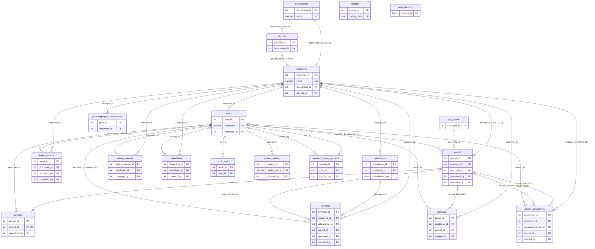

# Em-Ployger Database: Primary and Foreign Keys

This document lists the primary key of every table in `employger_db`, every foreign key that links the tables, and what each foreign key does when a linked row is deleted. It covers migrations V1 to V16, in [db/migrations](../db/migrations).

The keys are defined in the database itself, not only in the application code. MariaDB enforces them: it refuses a row that points to something that doesn't exist, and it applies each delete rule automatically. The query in [section 6](#6-checking-the-keys-in-the-database) lists them straight from MariaDB.

## Terms

| Term | Meaning |
|---|---|
| **Primary key (PK)** | The column that identifies one row, e.g. `employee_id`. Every table has one. All are `AUTO_INCREMENT`, so MariaDB numbers new rows itself. |
| **Foreign key (FK)** | A column that holds another table's primary key, e.g. `payroll.employee_id` holds the `employee_id` of the employee being paid. MariaDB refuses a value that doesn't exist in the other table. |
| **Unique key** | A column, or set of columns, that no two rows may share, e.g. one payroll per employee per pay cycle. |
| **ON DELETE CASCADE** | Deleting the parent row also deletes these rows. |
| **ON DELETE SET NULL** | Deleting the parent row keeps these rows and empties the link. |
| **ON DELETE RESTRICT** | The parent row can't be deleted while these rows point to it. |

Every foreign key also has **ON UPDATE CASCADE**: if a primary key value ever changed, the links would follow it. The application never changes primary keys.

---

## 1. Summary

| # | Table | Primary key | Foreign keys | What it holds |
|---|---|---|---|---|
| 1 | `employees` | `employee_id` | 2 | People on the payroll |
| 2 | `users` | `user_id` | 1 | Logins and their roles |
| 3 | `attendance` | `attendance_id` | 1 | One record per employee per day |
| 4 | `overtime` | `overtime_id` | 5 | Overtime requests, decisions and cancellations |
| 5 | `leave_requests` | `leave_id` | 3 | Leave requests and decisions |
| 6 | `pay_cycles` | `pay_cycle_id` | none | Pay periods (weekly, semi-monthly and so on) |
| 7 | `payroll` | `payroll_id` | 4 | One employee's pay for one pay cycle |
| 8 | `payslips` | `payslip_id` | 2 | The payslip of a PAID payroll |
| 9 | `bonuses` | `bonus_id` | 3 | Earnings: 13th month pay, bonuses, allowances, de minimis benefits |
| 10 | `payroll_adjustments` | `adjustment_id` | 4 | Corrections of PAID payroll |
| 11 | `salary_changes` | `salary_change_id` | 2 | Salary history with effective dates |
| 12 | `prior_employer_compensation` | `prior_id` | 1 | Pay from a previous employer in the same year (BIR 2316) |
| 13 | `holidays` | `holiday_id` | none | Regular, special and double holidays |
| 14 | `system_settings` | `setting_id` | 1 | Rates and rules, e.g. `factor_rate` |
| 15 | `audit_logs` | `audit_id` | 1 | Who changed what, and when |
| 16 | `login_attempts` | `attempt_id` | none | Failed logins, for lockouts |
| 17 | `deductions` | `deduction_id` | 2 | Not used yet (reserved for loans and cash advances) |
| 18 | `password_reset_requests` | `request_id` | 2 | "Forgot password" requests waiting for an administrator |
| 19 | `departments` | `department_id` | none | The Department choices on the Employee form |
| 20 | `job_titles` | `job_title_id` | 1 | The Job Title choices, each under one department |

20 tables and 35 foreign keys in all.

---

## 2. Foreign keys, table by table

### People and logins

**`employees`**: PK `employee_id`. Unique: `email`.

| Column | References | On delete | Why |
|---|---|---|---|
| `department_id` | `departments.department_id` | RESTRICT | (V16) The employee's department, from the choice list. An entry in use can't be deleted; it is retired instead, and the employee keeps it. |
| `job_title_id` | `job_titles.job_title_id` | RESTRICT | (V16) The employee's job title. The app checks that it belongs to the employee's department. |

The old text columns `department` and `job_title` are still there after V16, holding the values from before it. The app no longer reads or writes them; a later migration can drop them once the lists are confirmed.

**`departments`** (V16): PK `department_id`. Unique: `name`. No foreign keys.

**`job_titles`** (V16): PK `job_title_id`. Unique: (`department_id`, `name`), so two departments may each have a "Clerk", but one department can't have two.

| Column | References | On delete | Why |
|---|---|---|---|
| `department_id` | `departments.department_id` | RESTRICT | Job titles depend on the department. A department with job titles can't be deleted; it is retired instead. |

**`users`**: PK `user_id`. Unique: `username`.

| Column | References | On delete | Why |
|---|---|---|---|
| `employee_id` | `employees.employee_id` | SET NULL | A login belongs to one employee. If that employee's row is deleted, the login stays, unlinked, for an administrator to deal with. |

**`password_reset_requests`** (V15): PK `request_id`.

| Column | References | On delete | Why |
|---|---|---|---|
| `user_id` | `users.user_id` | CASCADE | The login that asked for a reset. A request means nothing without its login, so it goes with it. |
| `handled_by` | `users.user_id` | SET NULL | The administrator who set the temporary password or dismissed the request. |

### Time and requests

**`attendance`**: PK `attendance_id`. Unique: (`employee_id`, `attendance_date`), so there is one record per employee per day.

| Column | References | On delete | Why |
|---|---|---|---|
| `employee_id` | `employees.employee_id` | CASCADE | Attendance means nothing without its employee. |

**`overtime`**: PK `overtime_id`.

| Column | References | On delete | Why |
|---|---|---|---|
| `employee_id` | `employees.employee_id` | CASCADE | As for attendance. |
| `attendance_id` | `attendance.attendance_id` | SET NULL | Overtime is filed against a worked day. Attendance is no longer deleted by the app (V14), so this only protects the record. |
| `payroll_id` | `payroll.payroll_id` | SET NULL | The payroll that paid it (V2). Deleting a DRAFT payroll frees its overtime for the next one. |
| `approved_by` | `users.user_id` | SET NULL | Who approved or rejected it. Removing that login keeps the decision. |
| `cancelled_by` | `users.user_id` | SET NULL | Who cancelled it (V14). |

**`leave_requests`**: PK `leave_id`.

| Column | References | On delete | Why |
|---|---|---|---|
| `employee_id` | `employees.employee_id` | CASCADE | |
| `approved_by` | `users.user_id` | SET NULL | Who decided. |
| `cancelled_by` | `users.user_id` | SET NULL | Who cancelled (V14). |

### Payroll

**`pay_cycles`**: PK `pay_cycle_id`. No foreign keys: a pay cycle is a period of time and depends on nothing else.

**`payroll`**: PK `payroll_id`. Unique: (`employee_id`, `pay_cycle_id`), so one employee is paid once per cycle.

| Column | References | On delete | Why |
|---|---|---|---|
| `employee_id` | `employees.employee_id` | **RESTRICT** | Changed from CASCADE in V2: an employee with payroll history can't be deleted, so paid payroll is never lost. Set the employee INACTIVE instead. |
| `pay_cycle_id` | `pay_cycles.pay_cycle_id` | RESTRICT (default) | A pay cycle with payroll can't be deleted. |
| `processed_by` | `users.user_id` | SET NULL | Who processed it. |
| `approved_by` | `users.user_id` | SET NULL | The General Manager who signed it off (V10). |

**`payslips`**: PK `payslip_id`. Unique: `payroll_id`, so there is at most one payslip per payroll.

| Column | References | On delete | Why |
|---|---|---|---|
| `payroll_id` | `payroll.payroll_id` | CASCADE | A payslip only exists for its payroll. |
| `generated_by` | `users.user_id` | SET NULL | Who marked the payroll paid. |

**`bonuses`** (earnings): PK `bonus_id`.

| Column | References | On delete | Why |
|---|---|---|---|
| `employee_id` | `employees.employee_id` | CASCADE | |
| `payroll_id` | `payroll.payroll_id` | SET NULL | The payroll that paid it (V6). |
| `created_by` | `users.user_id` | SET NULL | Who entered it. |

**`payroll_adjustments`**: PK `adjustment_id`.

| Column | References | On delete | Why |
|---|---|---|---|
| `employee_id` | `employees.employee_id` | RESTRICT | A correction is payroll history. |
| `corrected_payroll_id` | `payroll.payroll_id` | RESTRICT | The PAID payroll it corrects can never be deleted. |
| `payroll_id` | `payroll.payroll_id` | SET NULL | The later payroll that settles it. |
| `created_by` | `users.user_id` | SET NULL | Who recorded it. |

**`salary_changes`**: PK `salary_change_id`.

| Column | References | On delete | Why |
|---|---|---|---|
| `employee_id` | `employees.employee_id` | CASCADE | Like attendance: the app deletes an employee only before any payroll exists. |
| `changed_by` | `users.user_id` | SET NULL | Who changed the salary. |

**`prior_employer_compensation`**: PK `prior_id`. Unique: (`employee_id`, `tax_year`).

| Column | References | On delete | Why |
|---|---|---|---|
| `employee_id` | `employees.employee_id` | CASCADE | |

### System

**`system_settings`**: PK `setting_id`. Unique: `setting_name`.

| Column | References | On delete | Why |
|---|---|---|---|
| `updated_by` | `users.user_id` | SET NULL | Who last changed the setting. |

**`audit_logs`**: PK `audit_id`.

| Column | References | On delete | Why |
|---|---|---|---|
| `user_id` | `users.user_id` | SET NULL | **The entry is never deleted with the login.** It stays, and shows "(system)" for the user. |

**`deductions`** (not used yet): PK `deduction_id`. FKs `employee_id` → `employees` (CASCADE) and `created_by` → `users` (SET NULL).

---

## 3. Tables with no foreign keys, and why

| Table | Why it has none |
|---|---|
| `departments` | A department name. Employees and job titles point to it. |
| `pay_cycles` | A period of time; it doesn't belong to anyone. Payroll points to it. |
| `holidays` | A calendar date and its type, the same for everyone. Payroll looks it up by date. |
| `login_attempts` | Counts failed logins by **username or IP address as typed**, including usernames that don't exist. A foreign key to `users` would make it impossible to count attempts on made-up usernames, which is exactly what lockouts must catch. |

---

## 4. What the delete rules protect

- **Paid payroll can't disappear.** `payroll.employee_id` is RESTRICT, so an employee with payroll can't be deleted, and `payroll_adjustments.corrected_payroll_id` keeps the payroll it corrects. The app also refuses these deletes with a clear message before MariaDB has to.
- **History outlives the people who made it.** Every "who did it" column (`approved_by`, `processed_by`, `cancelled_by`, `changed_by`, `created_by`, `generated_by`, `updated_by`, `handled_by`, `audit_logs.user_id`) is SET NULL. Removing a login never removes the records that login made.
- **A choice in use can't vanish.** `employees.department_id`, `employees.job_title_id` and `job_titles.department_id` are RESTRICT. Departments and job titles are never deleted, only retired, so no employee loses theirs.
- **Nothing is left dangling.** When an employee with no payroll is removed, their attendance, overtime, leave, earnings and salary history go with them (CASCADE), so no row points to an employee who doesn't exist.

---

## 5. Diagram

`||--o{` means "one to many": one employee has many attendance records. `|o--o|` means "zero or one to zero or one". Each line is one foreign key, labelled with its column.



GitHub and VS Code (with a Mermaid preview extension) draw this as a diagram. Anywhere else, paste it into <https://mermaid.live>.

---

## 6. Checking the keys in the database

These queries read MariaDB's own catalog (`information_schema`), so they show what is actually enforced. They only read; nothing is changed. Run them in HeidiSQL or the MariaDB client while connected to the server on port 3307.

**Every primary key:**

```sql
SELECT TABLE_NAME AS `table`, COLUMN_NAME AS primary_key
FROM information_schema.KEY_COLUMN_USAGE
WHERE TABLE_SCHEMA = 'employger_db' AND CONSTRAINT_NAME = 'PRIMARY'
ORDER BY TABLE_NAME;
```

**Every foreign key, with its delete rule:**

```sql
SELECT k.TABLE_NAME AS `table`,
       k.COLUMN_NAME AS `column`,
       k.REFERENCED_TABLE_NAME AS references_table,
       k.REFERENCED_COLUMN_NAME AS references_column,
       r.DELETE_RULE AS on_delete,
       k.CONSTRAINT_NAME AS constraint_name
FROM information_schema.KEY_COLUMN_USAGE k
JOIN information_schema.REFERENTIAL_CONSTRAINTS r
  ON r.CONSTRAINT_SCHEMA = k.CONSTRAINT_SCHEMA AND r.CONSTRAINT_NAME = k.CONSTRAINT_NAME
WHERE k.TABLE_SCHEMA = 'employger_db' AND k.REFERENCED_TABLE_NAME IS NOT NULL
ORDER BY k.TABLE_NAME, k.COLUMN_NAME;
```

The second query should return 35 rows once V13 to V16 are applied. Without them it returns 26: `salary_changes` (2 keys, V13), the two `cancelled_by` keys (V14), `password_reset_requests` (2 keys, V15) and the three department and job title keys (V16) aren't there yet. A foreign key with no `ON DELETE` rule in its migration shows as `RESTRICT`, MariaDB's default.

**One table's full definition:**

```sql
SHOW CREATE TABLE payroll;
```
