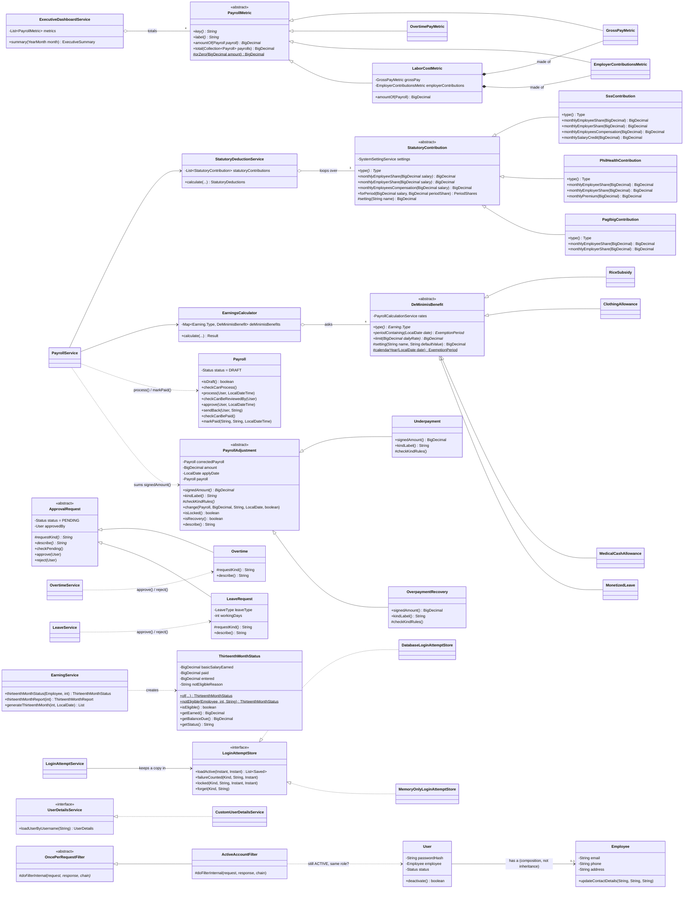

# OOP Concepts in Em-Ployger

This guide points to the exact code that shows each of the four OOP principles in Em-Ployger, a Philippine payroll system. Each section gives the class, where it is (`file:line`), and a few sentences you can say in the presentation.

Everything here is real payroll behaviour. Nothing exists only to demonstrate a concept. The refactor that introduced these classes changed no payroll amount, which section 7 explains how we proved.

---

## 1. Abstraction

**Idea:** code works with a general concept and does not need to know which specific one it has.

### `StatutoryContribution`: "a government contribution"

[src/main/java/com/employger/service/contribution/StatutoryContribution.java:17](../src/main/java/com/employger/service/contribution/StatutoryContribution.java#L17)

```java
public abstract class StatutoryContribution {
    public abstract Type type();
    public abstract BigDecimal monthlyEmployeeShare(BigDecimal salary);
    public abstract BigDecimal monthlyEmployerShare(BigDecimal salary);
    public BigDecimal monthlyEmployeesCompensation(BigDecimal salary) { return BigDecimal.ZERO; }
    public final PeriodShares forPeriod(BigDecimal salary, BigDecimal periodShare) { ... }
}
```

> "Every Philippine employer must pay SSS, PhilHealth and Pag-IBIG. They have different formulas, but payroll only needs to ask each one the same two questions: how much does the employee pay, and how much does the employer pay? `StatutoryContribution` is that common idea. It is `abstract` because a 'contribution in general' has no formula; only SSS, PhilHealth or Pag-IBIG do."

### `DeMinimisBenefit`: "a tax-free benefit up to a limit"

[src/main/java/com/employger/service/earning/DeMinimisBenefit.java:15](../src/main/java/com/employger/service/earning/DeMinimisBenefit.java#L15)

```java
public abstract class DeMinimisBenefit {
    public abstract Earning.Type type();
    public abstract ExemptionPeriod periodContaining(LocalDate date);
    public abstract BigDecimal limit(BigDecimal dailyRate);
}
```

> "BIR rules let some small benefits be tax-free up to a limit, for example rice subsidy, clothing, medical allowance and monetized leave. Each has its own period and limit, but the calculator treats them all the same way: find the period, find the limit, and see how much is still unused."

### `PayrollMetric`: "an amount the company overview totals"

[src/main/java/com/employger/service/metric/PayrollMetric.java:15](../src/main/java/com/employger/service/metric/PayrollMetric.java#L15)

```java
public abstract class PayrollMetric {
    public abstract String key();
    public abstract String label();
    public abstract BigDecimal amountOf(Payroll payroll);
    public final BigDecimal total(Collection<Payroll> payrolls) { ... }
}
```

> "The general manager's dashboard shows gross pay, overtime pay, employer contributions and labor cost, per month, per department and over six months. That's 4 metrics × 3 views. Instead of writing 12 loops, every metric answers one question, 'what does this one payroll contribute?', and the parent's `total()` does the adding and rounding for all of them."

---

## 2. Inheritance

**Idea:** a subclass gets the parent's state and behaviour and adds or replaces only what is different.

### Three contributions extend `StatutoryContribution`

| Class | Line | What it inherits | What it adds or replaces |
|---|---|---|---|
| `SssContribution` | [SssContribution.java:15](../src/main/java/com/employger/service/contribution/SssContribution.java#L15) | `forPeriod()`, `setting()`, the settings field | Monthly Salary Credit, employee and employer rates, **and EC** |
| `PhilHealthContribution` | [PhilHealthContribution.java:13](../src/main/java/com/employger/service/contribution/PhilHealthContribution.java#L13) | the same, plus the zero EC default | One premium within a floor and ceiling, split in two |
| `PagIbigContribution` | [PagIbigContribution.java:13](../src/main/java/com/employger/service/contribution/PagIbigContribution.java#L13) | the same, plus the zero EC default | Lower rate for low salaries, fund-salary cap |

> "Spreading a monthly amount over a pay cycle and rounding it to centavos is the same for every contribution, so it is written once, in the parent's `forPeriod()` method. It is `final`, so no subclass can round differently. The subclasses only contain what makes each contribution different."

### Four benefits extend `DeMinimisBenefit`

| Class | Line | Period | Limit |
|---|---|---|---|
| `RiceSubsidy` | [RiceSubsidy.java:12](../src/main/java/com/employger/service/earning/RiceSubsidy.java#L12) | Month | ₱2,000 |
| `ClothingAllowance` | [ClothingAllowance.java:12](../src/main/java/com/employger/service/earning/ClothingAllowance.java#L12) | Year (inherited `calendarYear()` helper) | ₱6,000 |
| `MedicalCashAllowance` | [MedicalCashAllowance.java:12](../src/main/java/com/employger/service/earning/MedicalCashAllowance.java#L12) | Half-year | ₱1,500 |
| `MonetizedLeave` | [MonetizedLeave.java:12](../src/main/java/com/employger/service/earning/MonetizedLeave.java#L12) | Year (inherited `calendarYear()` helper) | 10 days × daily rate |

The limits shown are the defaults. HR can change them in Settings.

### Overtime and leave extend `ApprovalRequest`

[src/main/java/com/employger/entity/ApprovalRequest.java](../src/main/java/com/employger/entity/ApprovalRequest.java)

Overtime and leave are both *requests that HR approves or rejects*. Before leave existed, overtime held that lifecycle itself. Now it lives once, in an abstract parent, and both extend it:

| Class | Inherits | Adds or overrides |
|---|---|---|
| `Overtime` | `status`, `approvedBy`, `checkPending()`, `approve()`, `reject()`, `isPending()` | hours, rate and amount; `requestKind()` = "overtime"; `describe()` |
| `LeaveRequest` | the same | leave type, dates, working days, reason; `requestKind()` = "leave"; `describe()` |

```java
public abstract class ApprovalRequest {
    protected abstract String requestKind();   // "overtime" or "leave"
    public abstract String describe();         // one line for the audit log

    public final void approve(User decidedBy) {
        checkPending();                        // "Only pending leave can be approved or rejected"
        this.status = Status.APPROVED;
        this.approvedBy = decidedBy;
    }
}
```

`approve()` and `reject()` are `final`, so no subclass can skip the "only pending" check. The parent only asks each subclass for its name and its one-line description, the two things that differ. This pattern is called a *template method*. It's a `@MappedSuperclass`, so there's no extra table: the `overtime` and `leave_requests` tables each have the `status` and `approved_by` columns declared once in the parent.

> "Overtime and leave go through exactly the same approval steps, so those steps are written once, in the parent, and can't be changed by the children. Each child only says what it's called and how to describe itself."

`LeaveRequest.LeaveType` also carries its own behaviour: `PAID` knows its days are recorded as `LEAVE` in attendance, and `UNPAID` knows its days are recorded as `ABSENT`. The service asks the type instead of using an `if`.

### Four metrics extend `PayrollMetric`

| Class | Line | `amountOf(payroll)` returns |
|---|---|---|
| `GrossPayMetric` | [GrossPayMetric.java:12](../src/main/java/com/employger/service/metric/GrossPayMetric.java#L12) | Gross pay |
| `OvertimePayMetric` | [OvertimePayMetric.java:12](../src/main/java/com/employger/service/metric/OvertimePayMetric.java#L12) | Overtime pay |
| `EmployerContributionsMetric` | [EmployerContributionsMetric.java:16](../src/main/java/com/employger/service/metric/EmployerContributionsMetric.java#L16) | Employer SSS + EC + PhilHealth + Pag-IBIG (missing values on older payroll count as zero, via the inherited `orZero()` helper) |
| `LaborCostMetric` | [LaborCostMetric.java:16](../src/main/java/com/employger/service/metric/LaborCostMetric.java#L16) | Gross pay + employer contributions |

### Composition instead of inheritance: `LaborCostMetric`

Labor cost is gross pay plus employer contributions. It would be easy to write `LaborCostMetric extends EmployerContributionsMetric` and add gross pay, but labor cost **is not a kind of** employer contribution. It is **made of** two other metrics. So `LaborCostMetric` extends only the general `PayrollMetric` and **holds** the two metrics it adds up ([LaborCostMetric.java:38](../src/main/java/com/employger/service/metric/LaborCostMetric.java#L38)):

```java
@Override
public BigDecimal amountOf(Payroll payroll) {
    return grossPay.amountOf(payroll).add(employerContributions.amountOf(payroll));
}
```

> "Inheritance means 'is a'; composition means 'has a'. Labor cost has a gross pay part and an employer-contribution part, so it holds them instead of extending one."

### Extending a framework class: `ActiveAccountFilter`

[src/main/java/com/employger/config/ActiveAccountFilter.java](../src/main/java/com/employger/config/ActiveAccountFilter.java)

```java
public class ActiveAccountFilter extends OncePerRequestFilter {

    @Override
    protected void doFilterInternal(HttpServletRequest request,
            HttpServletResponse response, FilterChain filterChain) { ... }
}
```

Spring's `OncePerRequestFilter` already knows how to run exactly once per request. Our filter inherits all of that and overrides only `doFilterInternal()`, the check itself: is this session's login still active, still there, and still in the same role? If not, the session ends and the person has to log in again.

> "We didn't write any of the filter machinery. We extended Spring's class and filled in the one method that is different for us."

---

### Corrections to paid payroll: `Underpayment` and `OverpaymentRecovery` extend `PayrollAdjustment`

[src/main/java/com/employger/entity/PayrollAdjustment.java](../src/main/java/com/employger/entity/PayrollAdjustment.java), [Underpayment.java](../src/main/java/com/employger/entity/Underpayment.java), [OverpaymentRecovery.java](../src/main/java/com/employger/entity/OverpaymentRecovery.java)

A mistake in PAID payroll is never fixed by changing that payroll. It is recorded as a correction that a later payroll settles. There are two kinds: the employee was paid too little, or too much. They share almost everything: the payroll they correct, the amount, the reason, the date of the cycle that settles them, the rule that they lock once that payroll is processed, and the checks on all of it. The abstract parent holds all of that once. Each subclass adds only what makes it different:

| | `Underpayment` | `OverpaymentRecovery` |
|---|---|---|
| `signedAmount()` | `+amount`: added to pay | `-amount`: deducted |
| `kindLabel()` | "Underpayment" | "Overpayment recovery" |
| `checkKindRules()` | nothing extra | refuses without the employee's written consent (Labor Code Art. 113) |

```java
public final void change(Payroll correctedPayroll, BigDecimal amount, String reason,
                         LocalDate applyDate, boolean employeeConsent) {
    checkNotLocked();
    // ... rules both kinds share: PAID payroll, amount > 0, a reason, a later cycle
    checkKindRules();      // then the subclass's own rule
}
```

`change()` is `final`: no subclass can skip the shared checks. It calls the abstract `checkKindRules()` at the end, so each kind adds its rule without repeating the rest. This is the *template method* pattern.

Both kinds live in one table, `payroll_adjustments`. The `kind` column (`@DiscriminatorColumn`) tells JPA which class to create when it reads a row (single-table inheritance).

## 3. Polymorphism

**Idea:** one call, many behaviours. The same method call runs a different implementation depending on the object's actual class at runtime.

### Payroll loops over contributions without knowing which is which

[src/main/java/com/employger/service/StatutoryDeductionService.java:166](../src/main/java/com/employger/service/StatutoryDeductionService.java#L166)

```java
for (StatutoryContribution contribution : statutoryContributions) {
    shares.put(contribution.type(), contribution.forPeriod(salary, periodShare));
}
```

> "This loop has no `if`, no `switch` and no `instanceof`. `forPeriod()` calls `monthlyEmployeeShare()`, and Java picks SSS's, PhilHealth's or Pag-IBIG's version at runtime. That is **dynamic dispatch**. Spring finds the three classes by their parent type and passes them in as a `List<StatutoryContribution>`."

Before the refactor, the service called `monthlySss(...)`, `monthlyPhilHealth(...)` and `monthlyPagIbig(...)` one by one by name.

### The tax-free calculator asks the object

[src/main/java/com/employger/service/EarningsCalculator.java:188-195](../src/main/java/com/employger/service/EarningsCalculator.java#L188-L195)

```java
DeMinimisBenefit benefit = deMinimisBenefits.get(entry.getEarningType());
...
DeMinimisBenefit.ExemptionPeriod period = benefit.periodContaining(entry.getDateGiven());
BigDecimal limit = benefit.limit(dailyRate);
```

Before the refactor, this was a `switch` over the four types, each case with its own period and limit.

### The company overview totals any metric the same way

[src/main/java/com/employger/service/ExecutiveDashboardService.java:79](../src/main/java/com/employger/service/ExecutiveDashboardService.java#L79)

```java
metrics.stream()
        .map(metric -> new MetricTotal(metric.key(), metric.label(), metric.total(monthPayroll)))
```

The same call fills the month totals, every department row and every month of the six-month trend. Adding a new figure to the dashboard, e.g. net pay, means adding one `PayrollMetric` subclass; the service, the API and the table code don't change.

### Overriding a default: only SSS has EC

The parent's `monthlyEmployeesCompensation()` is a **concrete** method that returns zero ([StatutoryContribution.java:50](../src/main/java/com/employger/service/contribution/StatutoryContribution.java#L50)). Only `SssContribution` overrides it ([SssContribution.java:39-40](../src/main/java/com/employger/service/contribution/SssContribution.java#L39-L40)), because Employees' Compensation is collected by SSS alone. The service adds the EC of every contribution and gets SSS's amount automatically.

### Existing interface implementation

`CustomUserDetailsService implements UserDetailsService` ([CustomUserDetailsService.java:14](../src/main/java/com/employger/service/CustomUserDetailsService.java#L14)). Spring Security calls `loadUserByUsername()` through the interface and runs our version.

### Payroll adds up corrections without knowing which is which

[src/main/java/com/employger/service/PayrollService.java](../src/main/java/com/employger/service/PayrollService.java), in `calculate()`

```java
BigDecimal adjustmentAmount = money(adjustments.stream()
        .map(PayrollAdjustment::signedAmount)
        .reduce(BigDecimal.ZERO, BigDecimal::add));
```

> "The payroll calculation never asks whether a correction is an underpayment or an overpayment. It asks each one for its `signedAmount()`, and the object answers. An underpayment of ₱500 and a recovery of ₱120.50 add up to +₱379.50 without an `if`."

The page, the API and the audit log work the same way. They show `kindLabel()` and `describe()`, and `isRecovery()` is worked out from the sign, so no code checks `instanceof`.

### Our own interface: `LoginAttemptStore`

[src/main/java/com/employger/service/login/LoginAttemptStore.java](../src/main/java/com/employger/service/login/LoginAttemptStore.java)

The password-guessing limit counts failed logins in memory, which is fast, and keeps a copy in a `LoginAttemptStore` so a restart doesn't clear a lockout early. `LoginAttemptStore` is an **interface**: it says *what* a store must do (`failureCounted()`, `locked()`, `forget()`, `loadActive()`...), not *how*. There are two implementations:

| Class | What it does | Used by |
|---|---|---|
| `DatabaseLoginAttemptStore` | Writes each change to the `login_attempts` table and reads it back at startup | The running app (Spring injects it) |
| `MemoryOnlyLoginAttemptStore` | Remembers nothing | Unit tests of the counting rules, which need no database |

`LoginAttemptService` only ever calls `store.failureCounted(...)` and so on. It doesn't know, or check, which store it was given: that's the same polymorphism as the contribution loop, through an interface instead of an abstract class.

> "The counting rules are written once. Where the counts are kept is a separate decision, behind an interface, so the tests can swap in a store with no database and the rules stay exactly the same."

---

## 4. Encapsulation

**Idea:** an object keeps its data private and lets it change only in valid ways.

### Payroll protects its own lifecycle: DRAFT → PROCESSED → APPROVED → PAID

[src/main/java/com/employger/entity/Payroll.java](../src/main/java/com/employger/entity/Payroll.java)

Since the General Manager sign-off (V10), `approve(reviewer, time)` and `sendBack(reviewer, reason)` sit between processing and payment. Both call `checkCanBeReviewedBy(reviewer)`, which refuses anything not PROCESSED **and** refuses the person who processed it: the "two different people" rule lives in the payroll object, not in a page or a service.

```java
public void process(User processedBy, LocalDateTime processedAt) {
    checkCanProcess();                 // throws unless DRAFT
    this.status = Status.PROCESSED;
    ...
}

public void markPaid(String paymentMethod, String paymentReference, LocalDateTime paymentDate) {
    checkCanBePaid();                  // throws unless PROCESSED
    this.status = Status.PAID;
    ...
}
```

> "A payroll can't be paid before it's processed, and a paid payroll can't be processed again. Before, only the service checked this, and it then set the status field directly. Now the payroll object enforces the rule itself, so any code that uses `process()` or `markPaid()` gets the check automatically."

There is **no `setStatus()`**: a new payroll starts as DRAFT, and `process()` and `markPaid()` are the only ways to change it. Code that tried to jump straight to PAID would not compile.

`PayrollService` calls `checkCanProcess()` first, before recalculating anything, and `process()` last ([PayrollService.java:968](../src/main/java/com/employger/service/PayrollService.java#L968), [:984](../src/main/java/com/employger/service/PayrollService.java#L984)).

### Overtime and leave: PENDING → APPROVED or REJECTED, then final

[src/main/java/com/employger/entity/ApprovalRequest.java](../src/main/java/com/employger/entity/ApprovalRequest.java), inherited by `Overtime` and `LeaveRequest`. `approve()` and `reject()` both refuse a request that has already been decided. There is no `setStatus()` either: new overtime starts PENDING. The status field is also marked `@JsonProperty(access = READ_ONLY)`, so a browser that sends `"status": "APPROVED"` is ignored, and a test proves it.

### A login can't outlive its permission

`User.deactivate()` switches a login off, and returns `false` if it was already off. `EmployeeService` calls it when an employee leaves the company, instead of setting the status field itself. `ActiveAccountFilter` (see Inheritance) then ends any session still open for that login.

### Employee contact details change together, through the object

[src/main/java/com/employger/entity/Employee.java:151](../src/main/java/com/employger/entity/Employee.java#L151)

```java
public void updateContactDetails(String email, String phone, String address) {
    if (email == null || email.isBlank()) {
        throw new IllegalArgumentException("Email is required.");
    }
    ...
}
```

Employees can now change their own email, phone and address on **My Details**, and HR can change them on the Employees page. Both go through this one method, so the rules are the same either way: email required and trimmed, a blank phone or address stored as empty. Before, HR's code set the three fields one by one.

### 13th month pay: one object decides what "earned" and "due" mean

[src/main/java/com/employger/service/ThirteenthMonthStatus.java](../src/main/java/com/employger/service/ThirteenthMonthStatus.java)

`ThirteenthMonthStatus` holds one employee's figures for a year: basic salary earned, what's already paid and what's entered but not yet paid. Its fields are `private final`, and its constructor is `private`. The only ways to make one are `of(...)` and `notEligible(employee, year, reason)`, so it can't hold an eligible employee's figures and a "not eligible" reason at once. Everything else is derived inside it:

```java
public BigDecimal getEarned() {
    if (!isEligible()) {
        return BigDecimal.ZERO.setScale(2);
    }
    return basicSalaryEarned.divide(TWELVE, 2, RoundingMode.HALF_UP);
}

public BigDecimal getBalanceDue() {
    return getEarned().subtract(paid).subtract(entered);
}
```

The Reports page, the employee's **My 13th Month** and the **Generate 13th Month Pay** button all use this one object (`EarningService.thirteenthMonthStatus()`), so they can never disagree about how much is earned or still due. Before, the generator worked these out inside its own loop.

### A payslip PDF can only exist for paid payroll

[src/main/java/com/employger/service/PayslipPdf.java](../src/main/java/com/employger/service/PayslipPdf.java)

`PayslipPdf`'s constructor refuses any payroll that isn't PAID, so no code anywhere can produce a "payslip" for pay that hasn't been made. Its fields are `private final`; outside code can ask only for `fileName()` and `toBytes()`. How the page is laid out (fonts, which lines appear, the "PHP" amounts) stays inside the class. Nothing is saved to disk: the PDF is built from the payroll on each download.

### Requests that only accept what the user may change

- `ContactDetailsRequest` ([ContactDetailsRequest.java:12](../src/main/java/com/employger/dto/ContactDetailsRequest.java#L12)) has exactly three fields: email, phone and address. If an employee's browser sends `"baseSalary": 999999` or `"department": "Executive"`, there's nowhere for it to go, so it's ignored. A test proves the salary stays unchanged.
- `OvertimeFilingRequest` ([OvertimeFilingRequest.java:15](../src/main/java/com/employger/dto/OvertimeFilingRequest.java#L15)) has only the date and the hours. The employee comes from the login, and the status, rate and amount are set by the server, so an employee can't file overtime for someone else or mark it approved.

### Hidden data

- Every entity field is `private`. For example, `User.passwordHash` ([User.java:26](../src/main/java/com/employger/entity/User.java#L26)) is never sent to the browser.
- Response DTOs such as `EmployeeResponse` and `EmployeeSummary` choose what leaves the server. Payroll lists show an employee's ID, name, department and job title, but never their salary, birth date, address or photo.
- The company overview for general managers returns totals only: no names, salaries or government numbers. A test checks the response contains none of them.
- Each `Earning.Type` keeps its own display label ([Earning.java:72-81](../src/main/java/com/employger/entity/Earning.java#L72-L81)) instead of a `switch` elsewhere.
- The contribution classes read rates only through the parent's `protected final setting()` method. The settings object itself is `private` to the parent.

---

## 5. Why `@Override` matters

Every method in this project that overrides or implements another method carries `@Override`, in the new classes and in the existing ones.

### 5.1 What it does

`@Override` is an instruction to the **compiler**: "this method must override a method of a parent class, or implement a method of an interface." If it doesn't, the build fails.

It changes nothing at runtime. The program behaves the same with or without it, *when the code is correct*. Its job is to turn a mistake that would otherwise be silent into a compile error.

### 5.2 The "silent bug"

`StatutoryContribution` has a concrete default method: EC is zero unless a subclass says otherwise. SSS is meant to replace it. Suppose a developer makes a one-letter typo: "Employee" instead of "Employees".

**Before: no `@Override`.**

```java
public class SssContribution extends StatutoryContribution {
    ...
    // Meant to replace the parent's zero default, but "Employee" is missing its "s".
    public BigDecimal monthlyEmployeeCompensation(BigDecimal salary) {
        return ...;   // 10 or 30 depending on the salary credit
    }
}
```

This **compiles with no errors**. Java sees a brand-new method that nobody calls. The parent's `monthlyEmployeesCompensation()` still runs and returns zero. We compiled and ran this against the project (javac 26):

```
EC per semi-monthly cycle: 0.00        (correct: 15.00)
```

Every payroll would understate the employer's SSS cost by ₱15 per cycle. Reports and remittances would be wrong, and nothing would warn anyone.

**After: with `@Override`.**

```java
    @Override
    public BigDecimal monthlyEmployeeCompensation(BigDecimal salary) { ... }
```

The build stops immediately. This is the real compiler output:

```
TypoSss.java:16: error: monthlyEmployeeCompensation(BigDecimal) in TypoSss does not override or implement a method from a supertype
    @Override
    ^
1 error
```

The same happens with the wrong parameter type, e.g. `monthlyEmployeesCompensation(double salary)` instead of `BigDecimal`. Java would treat that as an *overload* and keep running the parent's version, but `@Override` turns it into:

```
error: monthlyEmployeesCompensation(double) in TypoSss does not override or implement a method from a supertype
```

> **Why the example uses EC and not `monthlyEmployeeShare()`:** that method is `abstract`. A subclass that misspells an abstract method is already a compile error, because the class doesn't implement it. The silent bug can only happen when the parent method has a working default. That is exactly the case `@Override` exists for.

### 5.3 Refactoring insurance

Suppose next year someone renames the parent method, say `monthlyEmployeesCompensation(BigDecimal)` becomes `monthlyEcPremium(BigDecimal)`, or adds a parameter.

- **With `@Override`:** `SssContribution`'s method no longer overrides anything, so the build fails and points straight to it. The developer updates it in the same change.
- **Without it:** `SssContribution`'s old method silently becomes orphaned dead code, and EC drops to the parent's default without any warning.

The annotation turns "remember to update every subclass" into "the compiler lists every subclass you missed."

### 5.4 Readability and intent

When you read `SssContribution` and see:

```java
@Override
public BigDecimal monthlyEmployerShare(BigDecimal salary)
```

you know at once that this method is part of a contract defined elsewhere, in `StatutoryContribution`, and that code calling the parent type will run it. Without the annotation, you would have to open every parent class to tell a contract method from a helper like `monthlySalaryCredit()`.

---

## 6. What we deliberately did not build

Good OOP also means not adding classes that don't earn their place.

| Idea | Decision | Why |
|---|---|---|
| An abstract `Person` parent for `Employee` and `User` | Not built | A `User` is a login (username, password hash, role, status) that **has an** `Employee` ([User.java:19](../src/main/java/com/employger/entity/User.java#L19)). That is **composition**. They aren't two kinds of person, and making them inherit from one class would mean re-mapping two database tables for no benefit. |
| A "deductions" class hierarchy | Not built | The `deductions` table exists but is empty and unused. The real deductions are statutory contributions, already modelled above, and attendance deductions for unpaid hours. |
| A class for every earning type | Not built | 13th month pay, other benefits, hazard pay and taxable allowances behave alike: each is summed into its own payroll column, and the tax rules apply to the totals. Only the four de minimis kinds differ per type, so only they got subclasses. |
| Effective-dated rates | Not built | The system keeps one current value per rate in Settings. Dated rates would be a new feature, not a refactor. |

---

## 7. How we know nothing changed

*(This section is about the 2026-10-24 refactor. The role features added afterwards are covered by their own tests: 23 more, 267 in total.)*

- **Golden comparison.** Before the refactor, a temporary test recorded 360 results: statutory deductions for 27 salaries × 4 pay cycle types × with and without the minimum wage exemption, plus de minimis exemptions for every type on boundary dates like 30 June and 1 July. After each step, the same test was run again, and **all 360 lines were identical**, to the centavo, including the payroll notes.
- **Tests.** The 204 existing tests still pass, with the same expected values. Unit tests that used to call `service.monthlySss(...)` now call `sss.monthlyEmployeeShare(...)` with the same figures. 40 new tests cover each contribution and benefit class, the polymorphic loop, the Spring wiring, and every allowed and refused lifecycle transition. Total: 244 tests, 0 failures.
- **Database.** No entity mapping changed and no migration was added. Paid payroll #6 and `default_overtime_rate` = 1.25 were checked in the live database after the change.

---

## 8. Class diagram



`LaborCostMetric *-- GrossPayMetric` is a composition arrow: labor cost is built from the other two metrics rather than inheriting from them. In this diagram, `*` after a method marks abstract methods and `$` marks static ones. `#` means protected, `-` private and `+` public. The subclasses' listed methods are the ones marked `@Override`, except `monthlySalaryCredit()` and `monthlyPremium()`, which are each class's own helpers.
