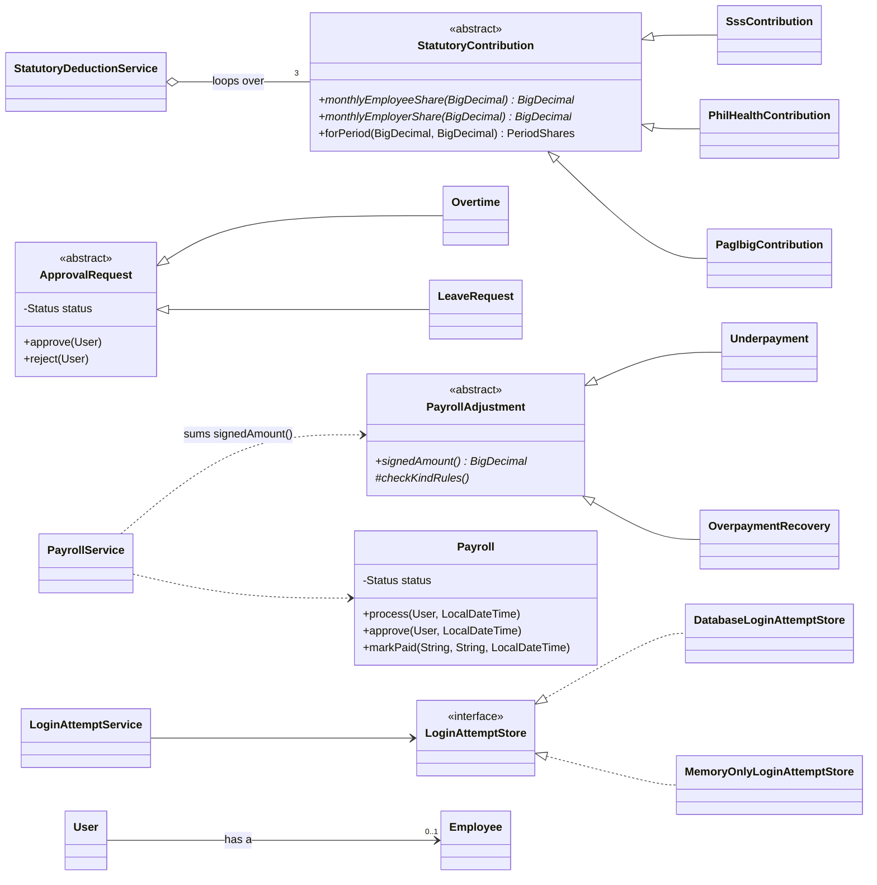

# OOP Concepts in Em-Ployger

This guide covers the four OOP principles as Em-Ployger, a Philippine payroll system, applies them. It lists only the clearest example of each. Every class here does real payroll work, and none was written just to show a concept.

---

## 1. Abstraction

**Idea:** code works with a general concept and doesn't need to know which specific one it has.

### `StatutoryContribution`: "a government contribution"

[StatutoryContribution.java:17](../src/main/java/com/employger/service/contribution/StatutoryContribution.java#L17)

```java
public abstract class StatutoryContribution {
    public abstract BigDecimal monthlyEmployeeShare(BigDecimal salary);
    public abstract BigDecimal monthlyEmployerShare(BigDecimal salary);
    public final PeriodShares forPeriod(BigDecimal salary, BigDecimal periodShare) { ... }
}
```

SSS, PhilHealth and Pag-IBIG each use a different formula. Payroll asks each of them the same two questions: how much does the employee pay, and how much does the employer pay? The class is `abstract` because a contribution in general has no formula. Only a specific contribution does.

### `LoginAttemptStore`: an interface

[LoginAttemptStore.java](../src/main/java/com/employger/service/login/LoginAttemptStore.java)

The interface says what a store of failed logins must do (`failureCounted()`, `locked()`, `forget()`, `loadActive()`). It doesn't say how. `LoginAttemptService` uses the interface only and never sees how the store works.

### `SalaryChangeRule`: "a rule for when a raise may take effect"

[SalaryChangeRule.java](../src/main/java/com/employger/service/salary/SalaryChangeRule.java)

```java
public abstract class SalaryChangeRule {
    public abstract void check(Employee employee, LocalDate effectiveDate, LocalDate today);
}
```

A salary change must pass several rules before it is saved. `SalaryHistoryService` only knows that each rule can `check()` a date. It doesn't know what any rule checks.

---

## 2. Inheritance

**Idea:** a subclass gets the parent's state and behaviour, and adds or replaces only what is different.

### SSS, PhilHealth and Pag-IBIG extend `StatutoryContribution`

| Class | Adds |
|---|---|
| `SssContribution` | Monthly Salary Credit, employee and employer rates, and EC |
| `PhilHealthContribution` | One premium between a floor and a ceiling, split in two |
| `PagIbigContribution` | A lower rate for low salaries and a cap on the salary used |

Spreading a monthly amount over a pay cycle and rounding it to centavos is the same for every contribution. That step is written once, in the parent's `forPeriod()`. It is `final`, so no subclass can round differently.

### Overtime and leave extend `ApprovalRequest`

[ApprovalRequest.java](../src/main/java/com/employger/entity/ApprovalRequest.java)

Overtime and leave both go through the same steps: PENDING, then APPROVED or REJECTED, and a pending or approved request can later be CANCELLED. The parent holds `status`, `approvedBy`, the reasons, `approve()`, `reject()` and `cancel()`. `Overtime` adds hours and rate, and `LeaveRequest` adds the leave type and dates.

```java
public final void reject(User decidedBy, String remarks) {
    checkPending();                                      // only a pending request can be decided
    this.decisionRemarks = requireReason(remarks, "reject");  // no reason, no rejection
    this.status = Status.REJECTED;
    this.approvedBy = decidedBy;
}
```

The "a reason is required" rule is written once, in the parent, so overtime and leave can't differ on it. `cancel()` is also `final` and calls a hook, `checkCancellable()`, which does nothing by default. `LeaveRequest` overrides it to refuse cancelling approved leave, because its days are already recorded in attendance:

```java
@Override
protected void checkCancellable() {
    if (getStatus() == Status.APPROVED) {
        throw new IllegalStateException("Approved leave has already been recorded in attendance ...");
    }
}
```

### Corrections to paid payroll extend `PayrollAdjustment`

[PayrollAdjustment.java](../src/main/java/com/employger/entity/PayrollAdjustment.java)

`Underpayment` and `OverpaymentRecovery` share the corrected payroll, the amount, the reason, the lock and all the checks. Each one adds only its sign (+ or −) and its own rule. A recovery needs the employee's written consent under Labor Code Art. 113. Both are stored in one table, `payroll_adjustments`, with a `kind` column (single-table inheritance).

### Three salary rules extend `SalaryChangeRule`

| Class | Refuses |
|---|---|
| `NotBeforeHireDate` | A date before the employee was hired |
| `NotMoreThanAYearAhead` | A date more than a year from today (a mistyped year) |
| `NotIntoProcessedPayroll` | A date inside a cycle whose payroll is already processed or paid. Pay owed for it is recorded as a correction instead. |

### Departments and job titles extend `ChoiceOption`

[ChoiceOption.java](../src/main/java/com/employger/entity/ChoiceOption.java), [Department.java](../src/main/java/com/employger/entity/Department.java), [JobTitle.java](../src/main/java/com/employger/entity/JobTitle.java)

Both choice lists on the Employee form work the same way: an entry has a name, can be renamed, retired and restored, and has a creation date. That is written once in the abstract `ChoiceOption` (a JPA `@MappedSuperclass`, so its columns appear in both tables). `rename()`, `retire()` and `restore()` are `final`, so the two lists can't drift apart. Each subclass adds only what differs: its own table and key (`@Override getId()`), what it is called (`@Override kind()`), and for `JobTitle`, its department. `JobTitle` also overrides `describe()` to add the department, since "Clerk" alone is ambiguous.

### Two summary reports extend `EmployeePeriodReport`

[EmployeePeriodReport.java](../src/main/java/com/employger/service/summary/EmployeePeriodReport.java)

The parent's `final rows()` decides once which employees are listed for a month, and in what order. `AttendanceSummaryReport` and `OvertimeSummaryReport` only say which records to read and how one employee's records become a row (`@Override rowFor()`).

> **Composition instead of inheritance.** A `User` (a login) **has an** `Employee`. It doesn't inherit from one. `LaborCostMetric` likewise **holds** the gross pay and employer contribution metrics and adds them up, because labor cost is made of those two amounts. It isn't a kind of either one.

---

## 3. Polymorphism

**Idea:** one method call, many behaviours. Java picks the implementation from the object's actual class at runtime.

### Payroll loops over contributions without knowing which is which

[StatutoryDeductionService.java:166](../src/main/java/com/employger/service/StatutoryDeductionService.java#L166)

```java
for (StatutoryContribution contribution : statutoryContributions) {
    shares.put(contribution.type(), contribution.forPeriod(salary, periodShare));
}
```

The loop has no `if`, no `switch` and no `instanceof`. Java runs the SSS, PhilHealth or Pag-IBIG formula depending on the object. This is called dynamic dispatch. Spring finds the three classes by their parent type and passes them in as a list.

### Payroll adds up corrections the same way

```java
adjustments.stream().map(PayrollAdjustment::signedAmount).reduce(BigDecimal.ZERO, BigDecimal::add)
```

An underpayment of ₱500 and a recovery of ₱120.50 add up to +₱379.50. Payroll never asks which kind each correction is.

### Every salary rule is checked the same way

[SalaryHistoryService.java](../src/main/java/com/employger/service/salary/SalaryHistoryService.java)

```java
for (SalaryChangeRule rule : rules) {
    rule.check(employee, effectiveDate, today);
}
```

Spring finds every `SalaryChangeRule` subclass and passes them in as a list. Adding a rule means adding one class; this loop doesn't change.

### Generating payroll for everyone: each outcome describes itself

[GenerationOutcome.java](../src/main/java/com/employger/service/bulk/GenerationOutcome.java)

**Generate for All** returns one outcome per employee: `Created` or `Skipped`. Both implement the sealed interface `GenerationOutcome` and override `result()` and `message()`. The page and the summary call `message()` on every outcome and never check which kind it is. A created payroll answers with its number and net pay, and a skipped one with the reason it was refused.

### Renaming and retiring: one method for both lists

[ChoiceListService.java](../src/main/java/com/employger/service/choice/ChoiceListService.java)

`renamed()` and `statusChanged()` take any `ChoiceOption`. They call `rename()`, `retire()` or `restore()` and write the audit entry from `auditPrefix()` and `describe()`. The entry's own class decides the words: `DEPARTMENT_RETIRED` with `Retired department "Sales"`, or `JOB_TITLE_RENAMED` with `Renamed job title "Clerk" in Finance to ...`. The service never asks which kind it has.

### Two security filters, one shape

[PasswordChangeRequiredFilter.java](../src/main/java/com/employger/config/PasswordChangeRequiredFilter.java), [ActiveAccountFilter.java](../src/main/java/com/employger/config/ActiveAccountFilter.java)

Both extend Spring's `OncePerRequestFilter`, which already makes sure a filter runs once per request. Each overrides `doFilterInternal()` with its own check: `ActiveAccountFilter` ends the session of a deactivated login, and `PasswordChangeRequiredFilter` refuses everything except choosing a new password while a login still has a temporary one. The second also overrides `shouldNotFilter()` to say which requests are always allowed (pages, login and logout, and the password change itself). Spring calls both the same way.

### Two implementations of one interface

`DatabaseLoginAttemptStore` saves lockouts to the database, so a restart doesn't clear them. `MemoryOnlyLoginAttemptStore` saves nothing, so unit tests need no database. `LoginAttemptService` works the same way with either one.

---

## 4. Encapsulation

**Idea:** an object keeps its data private and lets it change only in valid ways.

### Payroll protects its own lifecycle: DRAFT → PROCESSED → APPROVED → PAID

[Payroll.java](../src/main/java/com/employger/entity/Payroll.java)

```java
public void markPaid(String paymentMethod, String paymentReference, LocalDateTime paymentDate) {
    checkCanBePaid();            // throws unless APPROVED
    this.status = Status.PAID;
    ...
}
```

There is no `setStatus()`. `process()`, `approve()`, `sendBack()` and `markPaid()` are the only ways to change the status, and each checks the current state first. The payroll object itself refuses a review by the same person who processed it.

### Salary history can't be edited, only added to

[SalaryChange.java](../src/main/java/com/employger/entity/SalaryChange.java), [SalaryTimeline.java](../src/main/java/com/employger/service/salary/SalaryTimeline.java)

A `SalaryChange` has no setters, and `SalaryChange.record()` is the only way to make one. It refuses a salary of zero or less, and a missing date. Payroll never reads the salary history directly. It asks a `SalaryTimeline` for `salaryOn(date)`, and the timeline alone decides which change was in effect that day.

### A password reset request is closed once, and a temporary password never prints itself

[PasswordResetRequest.java](../src/main/java/com/employger/entity/PasswordResetRequest.java), [TemporaryPassword.java](../src/main/java/com/employger/service/password/TemporaryPassword.java)

A `PasswordResetRequest` has no setters. `open()` makes one, and `complete()` or `dismiss()` closes it; closing it a second time is refused. `User` likewise has no setter for its "must change password" flag: `setTemporaryPassword()` turns it on, and only `changeOwnPassword()` turns it off.

`TemporaryPassword` is a record that **overrides `toString()`** to return `TemporaryPassword[hidden]`. A record's default `toString()` would print the password, so one careless log line or error message could leak it. The value comes out only through `value()`, once, for the administrator to hand over.

### An employee's department and job title change together

[Employee.java](../src/main/java/com/employger/entity/Employee.java)

`Employee` has no separate setters for its department and job title. `assignPosition(department, jobTitle)` sets both at once and refuses a job title without a department, a job title from another department, and a retired entry the employee didn't already have. Reports and payslips still call `getDepartment()` and `getJobTitle()` and get names, as before V16; they don't need to know the names now come from the lists.

### The audit log filter builds its own query

[AuditLogFilter.java](../src/main/java/com/employger/service/AuditLogFilter.java)

The Audit Log page's filters (dates, user, action, text) are one record, `AuditLogFilter`. Its constructor refuses an end date before the start date and treats blank text as "any". `toSpecification()` turns the filter into the database query. The paged list and the CSV export both ask the filter for its query, so they can't disagree about which entries match.

### Only the allowed fields can come in, and only safe fields go out

- Every entity field is `private`. `User.passwordHash` is never sent to the browser.
- `ContactDetailsRequest` accepts only email, phone and address. If an employee's browser sends `"baseSalary": 999999`, the field doesn't exist there, so the value is ignored.
- Response DTOs choose what leaves the server. Payroll lists never include salary, birth date or address. The General Manager's overview returns totals only.

---

## 5. `@Override`

Every method that overrides a parent's method or implements an interface method carries `@Override`. The annotation makes the compiler check that the method really overrides something.

Suppose a developer misspells SSS's `monthlyEmployeesCompensation()` as `monthlyEmployeeCompensation()`:

- **Without `@Override`:** the code compiles. The parent's default of zero still runs, so every payroll understates the employer's SSS cost by ₱15 per cycle, with no warning.
- **With `@Override`:** the build fails with `method does not override or implement a method from a supertype`, and the typo is caught before anything runs.

---

## 6. Class diagram



`*` marks an abstract method, `-` private, `#` protected and `+` public.
