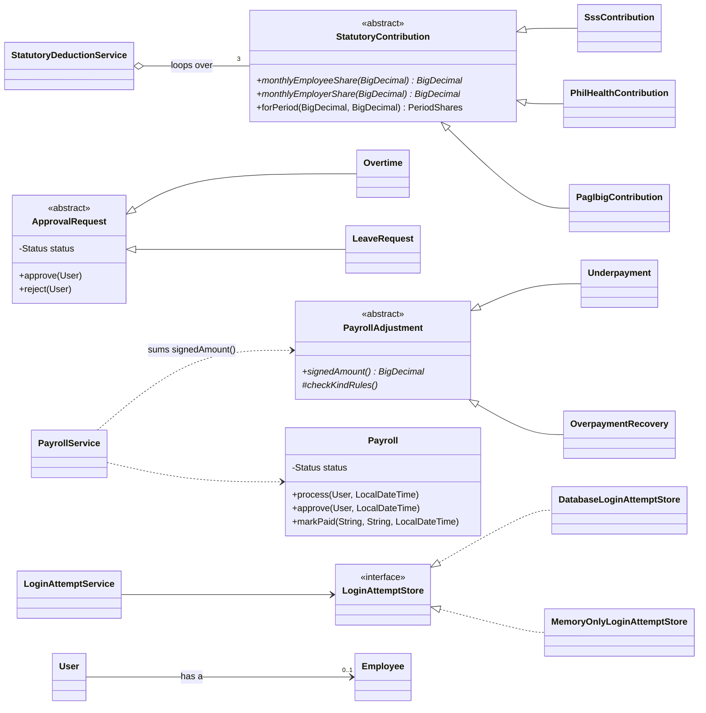

# OOP Concepts in Em-Ployger

This guide covers the four OOP principles as Em-Ployger, a Philippine payroll system, applies them. It lists only the clearest example of each. Every class here does real payroll work, and none was written just to show a concept.

---

## 1. Abstraction

**Idea:** code works with a general concept and doesn't need to know which specific one it has.

### `StatutoryContribution`: "a government contribution"

[StatutoryContribution.java:17](../src/main/java/com/employger/service/contribution/StatutoryContribution.java#L17)

```java
public abstract class StatutoryContribution {
    public abstract BigDecimal monthlyEmployeeShare(BigDecimal salary);
    public abstract BigDecimal monthlyEmployerShare(BigDecimal salary);
    public final PeriodShares forPeriod(BigDecimal salary, BigDecimal periodShare) { ... }
}
```

SSS, PhilHealth and Pag-IBIG each use a different formula. Payroll asks each of them the same two questions: how much does the employee pay, and how much does the employer pay? The class is `abstract` because a contribution in general has no formula. Only a specific contribution does.

### `LoginAttemptStore`: an interface

[LoginAttemptStore.java](../src/main/java/com/employger/service/login/LoginAttemptStore.java)

The interface says what a store of failed logins must do (`failureCounted()`, `locked()`, `forget()`, `loadActive()`). It doesn't say how. `LoginAttemptService` uses the interface only and never sees how the store works.

---

## 2. Inheritance

**Idea:** a subclass gets the parent's state and behaviour, and adds or replaces only what is different.

### SSS, PhilHealth and Pag-IBIG extend `StatutoryContribution`

| Class | Adds |
|---|---|
| `SssContribution` | Monthly Salary Credit, employee and employer rates, and EC |
| `PhilHealthContribution` | One premium between a floor and a ceiling, split in two |
| `PagIbigContribution` | A lower rate for low salaries and a cap on the salary used |

Spreading a monthly amount over a pay cycle and rounding it to centavos is the same for every contribution. That step is written once, in the parent's `forPeriod()`. It is `final`, so no subclass can round differently.

### Overtime and leave extend `ApprovalRequest`

[ApprovalRequest.java](../src/main/java/com/employger/entity/ApprovalRequest.java)

Overtime and leave both go through the same steps: PENDING, then APPROVED or REJECTED. The parent holds `status`, `approvedBy`, `approve()` and `reject()`. `Overtime` adds hours and rate, and `LeaveRequest` adds the leave type and dates.

```java
public final void approve(User decidedBy) {
    checkPending();              // only a pending request can be decided
    this.status = Status.APPROVED;
    this.approvedBy = decidedBy;
}
```

### Corrections to paid payroll extend `PayrollAdjustment`

[PayrollAdjustment.java](../src/main/java/com/employger/entity/PayrollAdjustment.java)

`Underpayment` and `OverpaymentRecovery` share the corrected payroll, the amount, the reason, the lock and all the checks. Each one adds only its sign (+ or −) and its own rule. A recovery needs the employee's written consent under Labor Code Art. 113. Both are stored in one table, `payroll_adjustments`, with a `kind` column (single-table inheritance).

> **Composition instead of inheritance.** A `User` (a login) **has an** `Employee`. It doesn't inherit from one. `LaborCostMetric` likewise **holds** the gross pay and employer contribution metrics and adds them up, because labor cost is made of those two amounts. It isn't a kind of either one.

---

## 3. Polymorphism

**Idea:** one method call, many behaviours. Java picks the implementation from the object's actual class at runtime.

### Payroll loops over contributions without knowing which is which

[StatutoryDeductionService.java:166](../src/main/java/com/employger/service/StatutoryDeductionService.java#L166)

```java
for (StatutoryContribution contribution : statutoryContributions) {
    shares.put(contribution.type(), contribution.forPeriod(salary, periodShare));
}
```

The loop has no `if`, no `switch` and no `instanceof`. Java runs the SSS, PhilHealth or Pag-IBIG formula depending on the object. This is called dynamic dispatch. Spring finds the three classes by their parent type and passes them in as a list.

### Payroll adds up corrections the same way

```java
adjustments.stream().map(PayrollAdjustment::signedAmount).reduce(BigDecimal.ZERO, BigDecimal::add)
```

An underpayment of ₱500 and a recovery of ₱120.50 add up to +₱379.50. Payroll never asks which kind each correction is.

### Two implementations of one interface

`DatabaseLoginAttemptStore` saves lockouts to the database, so a restart doesn't clear them. `MemoryOnlyLoginAttemptStore` saves nothing, so unit tests need no database. `LoginAttemptService` works the same way with either one.

---

## 4. Encapsulation

**Idea:** an object keeps its data private and lets it change only in valid ways.

### Payroll protects its own lifecycle: DRAFT → PROCESSED → APPROVED → PAID

[Payroll.java](../src/main/java/com/employger/entity/Payroll.java)

```java
public void markPaid(String paymentMethod, String paymentReference, LocalDateTime paymentDate) {
    checkCanBePaid();            // throws unless APPROVED
    this.status = Status.PAID;
    ...
}
```

There is no `setStatus()`. `process()`, `approve()`, `sendBack()` and `markPaid()` are the only ways to change the status, and each checks the current state first. The payroll object itself refuses a review by the same person who processed it.

### Only the allowed fields can come in, and only safe fields go out

- Every entity field is `private`. `User.passwordHash` is never sent to the browser.
- `ContactDetailsRequest` accepts only email, phone and address. If an employee's browser sends `"baseSalary": 999999`, the field doesn't exist there, so the value is ignored.
- Response DTOs choose what leaves the server. Payroll lists never include salary, birth date or address. The General Manager's overview returns totals only.

---

## 5. `@Override`

Every method that overrides a parent's method or implements an interface method carries `@Override`. The annotation makes the compiler check that the method really overrides something.

Suppose a developer misspells SSS's `monthlyEmployeesCompensation()` as `monthlyEmployeeCompensation()`:

- **Without `@Override`:** the code compiles. The parent's default of zero still runs, so every payroll understates the employer's SSS cost by ₱15 per cycle, with no warning.
- **With `@Override`:** the build fails with `method does not override or implement a method from a supertype`, and the typo is caught before anything runs.

---

## 6. Class diagram



`*` marks an abstract method, `-` private, `#` protected and `+` public.
