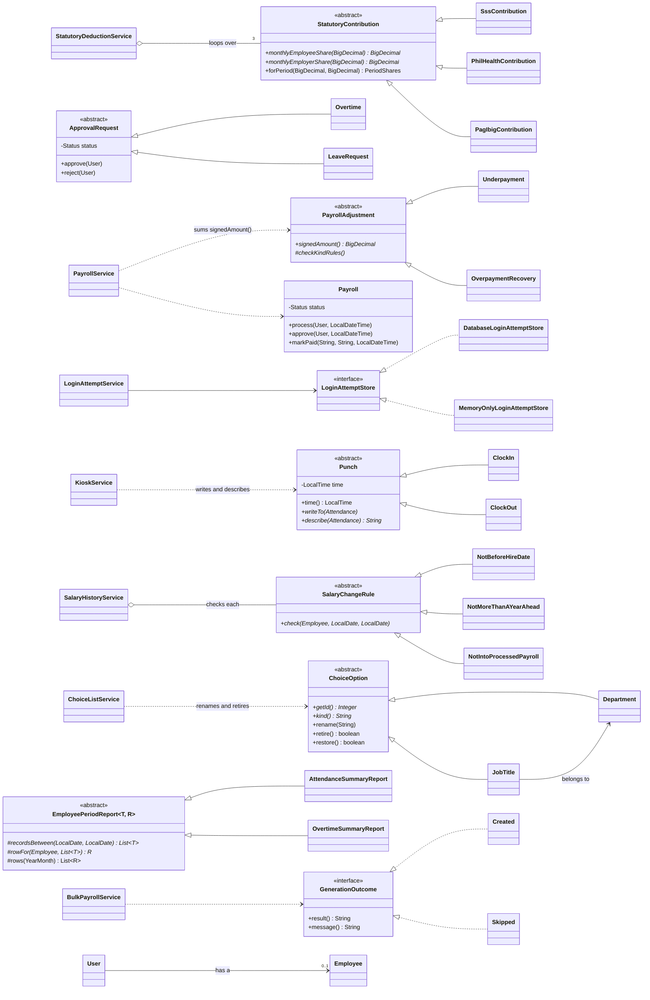

# OOP Concepts in Em-Ployger

This guide covers the four OOP principles as Em-Ployger, a Philippine payroll system, applies them. For each one it explains what the principle means, how the system uses it, and how the code runs, step by step. Every class here does real payroll work, and none was written just to show a concept.

## The four concepts at a glance

| Concept | In one sentence | Where Em-Ployger uses it | What it buys the system |
|---|---|---|---|
| **Abstraction** | Work with *what* something does, not *how* | Government contributions, salary rules, kiosk punches, login lockouts | Payroll code reads like the payroll rules, without formula details |
| **Inheritance** | Write shared behaviour once in a parent | Contributions, approval requests, payroll corrections, choice lists, reports, punches | One rule, one place: overtime and leave can't disagree on how a rejection works |
| **Polymorphism** | One call, and each object answers its own way | The loops in payroll, salary checks, the kiosk, bulk payroll generation | No `if`/`switch` on kinds; a new kind is a new class, not an edit everywhere |
| **Encapsulation** | An object guards its own data | Payroll status, salary history, password resets, badge codes, employee position | Invalid states (a paid DRAFT, a ₱0 salary) can't be created at all |

## How the system is built

Em-Ployger is a Spring Boot application in layers:

```
browser (static HTML/JS)
   │  JSON over HTTP
   ▼
controller/   receives a request, checks the role, calls a service
   ▼
service/      the business rules: payroll, deductions, kiosk, salary history ...
   ▼
entity/       the data objects (Payroll, Employee, Attendance ...), which guard their own state
   ▼
repository/   reads and writes the MariaDB database (Spring Data JPA)
```

Most of the OOP lives in two places:

- **`entity/`**: encapsulation (objects that refuse invalid changes) and inheritance shared by entities (`ApprovalRequest`, `PayrollAdjustment`, `ChoiceOption`).
- **`service/` sub-packages** (`contribution/`, `salary/`, `kiosk/`, `summary/`, `bulk/`, `login/`): abstraction and polymorphism. Each sub-package defines one abstract type plus its concrete kinds, and a service works only with the abstract type.

Spring helps polymorphism along. When a constructor asks for a `List<StatutoryContribution>` or a `List<SalaryChangeRule>`, Spring finds every `@Component` subclass and passes them all in. The service never names a concrete class.

---

## 1. Abstraction

**Idea:** code works with a general concept and doesn't need to know which specific one it has.

**How Em-Ployger applies it:** wherever the business has "several kinds of the same thing" (three government contributions, three salary rules, two kinds of badge scan, two ways to store lockouts), the code defines one `abstract` class or `interface` for the general idea. It holds only the questions every kind must answer, as abstract methods. Services are written against that type, so they read like the business rule ("ask every contribution for its share") and not like the formulas.

#### How the code works: computing one employee's contributions

1. `PayrollService` asks `StatutoryDeductionService.calculate()` for the deductions on a monthly salary of, say, ₱30,000 in a semi-monthly cycle.
2. The service holds a `List<StatutoryContribution>`. It doesn't know the list holds SSS, PhilHealth and Pag-IBIG, only that each item is "a contribution". At startup it checks that every `Type` appears exactly once.
3. It works out the period's share of a month (12 ÷ 24 = 0.5 for semi-monthly) and calls `forPeriod(salary, 0.5)` on each contribution.
4. `forPeriod()` calls the abstract `monthlyEmployeeShare()` and `monthlyEmployerShare()`, and each contribution answers with its own formula. PhilHealth, for example, clamps the salary between a floor and a ceiling, multiplies by the premium rate, and splits the premium.
5. The service adds up the employee shares, subtracts them from the taxable pay, and computes withholding tax.

The rates themselves (`philhealth_premium_rate`, `philhealth_salary_ceiling` ...) are read from system settings through the protected `setting()` helper, so a rate change needs no code change.

### `StatutoryContribution`: "a government contribution"

[StatutoryContribution.java:17](../src/main/java/com/employger/service/contribution/StatutoryContribution.java#L17)

```java
public abstract class StatutoryContribution {
    public abstract BigDecimal monthlyEmployeeShare(BigDecimal salary);
    public abstract BigDecimal monthlyEmployerShare(BigDecimal salary);
    public final PeriodShares forPeriod(BigDecimal salary, BigDecimal periodShare) { ... }
}
```

SSS, PhilHealth and Pag-IBIG each use a different formula. Payroll asks each of them the same two questions: how much does the employee pay, and how much does the employer pay? The class is `abstract` because a contribution in general has no formula. Only a specific contribution does.

### `LoginAttemptStore`: an interface

[LoginAttemptStore.java](../src/main/java/com/employger/service/login/LoginAttemptStore.java)

The interface says what a store of failed logins must do (`failureCounted()`, `locked()`, `forget()`, `loadActive()`). It doesn't say how. `LoginAttemptService` uses the interface only and never sees how the store works.

### `SalaryChangeRule`: "a rule for when a raise may take effect"

[SalaryChangeRule.java](../src/main/java/com/employger/service/salary/SalaryChangeRule.java)

```java
public abstract class SalaryChangeRule {
    public abstract void check(Employee employee, LocalDate effectiveDate, LocalDate today);
}
```

A salary change must pass several rules before it is saved. `SalaryHistoryService` only knows that each rule can `check()` a date. It doesn't know what any rule checks.

### `Punch`: "a badge scan at the kiosk"

[Punch.java](../src/main/java/com/employger/service/kiosk/Punch.java)

```java
public abstract sealed class Punch permits ClockIn, ClockOut {
    public abstract void writeTo(Attendance attendance);
    public abstract String direction();
    public abstract String auditAction();
    public abstract String describe(Attendance saved);
}
```

When an employee scans their badge, `KioskService` decides once whether it is a clock-in or a clock-out. From then on it only holds "a punch": something that can write itself into the day's attendance, name its audit action and describe itself for the kiosk screen. The class is `abstract` because a scan in general doesn't know what to write.

---

## 2. Inheritance

**Idea:** a subclass gets the parent's state and behaviour, and adds or replaces only what is different.

**How Em-Ployger applies it:** when two or more kinds share real data and real rules, the shared part goes into a parent class and each subclass keeps only its differences. The system uses three tools to stop subclasses from breaking the shared rules:

| Tool | What it does | Example |
|---|---|---|
| `final` method in the parent | A subclass can't override it, so the shared rule is the same for all | `forPeriod()`, `reject()`, `rename()`, `time()` |
| Hook method (empty default) | The parent's `final` method calls it; a subclass may override it to add a check | `checkCancellable()` in `ApprovalRequest` |
| `sealed ... permits` | Only the listed subclasses may exist | `Punch permits ClockIn, ClockOut` |

On entities, inheritance also decides the database layout. `PayrollAdjustment` uses **single-table inheritance** (one table with a `kind` column), and `ChoiceOption` is a **`@MappedSuperclass`** (its columns are copied into both the `departments` and `job_titles` tables).

#### How the code works: rejecting an overtime request

1. A manager clicks **Reject** and types a reason. `OvertimeService` loads the `Overtime` and calls `reject(manager, "Not pre-approved")`.
2. `Overtime` has no `reject()` of its own. Java runs the one inherited from `ApprovalRequest`.
3. The inherited method checks the request is still PENDING, requires a reason, then sets REJECTED and records who decided.
4. Rejecting a leave request runs exactly the same code. The two can't drift apart because `reject()` is `final` and lives in one place.

### SSS, PhilHealth and Pag-IBIG extend `StatutoryContribution`

| Class | Adds |
|---|---|
| `SssContribution` | Monthly Salary Credit, employee and employer rates, and EC |
| `PhilHealthContribution` | One premium between a floor and a ceiling, split in two |
| `PagIbigContribution` | A lower rate for low salaries and a cap on the salary used |

Spreading a monthly amount over a pay cycle and rounding it to centavos is the same for every contribution. That step is written once, in the parent's `forPeriod()`. It is `final`, so no subclass can round differently.

### Overtime and leave extend `ApprovalRequest`

[ApprovalRequest.java](../src/main/java/com/employger/entity/ApprovalRequest.java)

Overtime and leave both go through the same steps: PENDING, then APPROVED or REJECTED, and a pending or approved request can later be CANCELLED. The parent holds `status`, `approvedBy`, the reasons, `approve()`, `reject()` and `cancel()`. `Overtime` adds hours and rate, and `LeaveRequest` adds the leave type and dates.

```java
public final void reject(User decidedBy, String remarks) {
    checkPending();                                      // only a pending request can be decided
    this.decisionRemarks = requireReason(remarks, "reject");  // no reason, no rejection
    this.status = Status.REJECTED;
    this.approvedBy = decidedBy;
}
```

The "a reason is required" rule is written once, in the parent, so overtime and leave can't differ on it. `cancel()` is also `final` and calls a hook, `checkCancellable()`, which does nothing by default. `LeaveRequest` overrides it to refuse cancelling approved leave, because its days are already recorded in attendance:

```java
@Override
protected void checkCancellable() {
    if (getStatus() == Status.APPROVED) {
        throw new IllegalStateException("Approved leave has already been recorded in attendance ...");
    }
}
```

### Corrections to paid payroll extend `PayrollAdjustment`

[PayrollAdjustment.java](../src/main/java/com/employger/entity/PayrollAdjustment.java)

`Underpayment` and `OverpaymentRecovery` share the corrected payroll, the amount, the reason, the lock and all the checks. Each one adds only its sign (+ or −) and its own rule. A recovery needs the employee's written consent under Labor Code Art. 113. Both are stored in one table, `payroll_adjustments`, with a `kind` column (single-table inheritance).

### Three salary rules extend `SalaryChangeRule`

| Class | Refuses |
|---|---|
| `NotBeforeHireDate` | A date before the employee was hired |
| `NotMoreThanAYearAhead` | A date more than a year from today (a mistyped year) |
| `NotIntoProcessedPayroll` | A date inside a cycle whose payroll is already processed or paid. Pay owed for it is recorded as a correction instead. |

### Departments and job titles extend `ChoiceOption`

[ChoiceOption.java](../src/main/java/com/employger/entity/ChoiceOption.java), [Department.java](../src/main/java/com/employger/entity/Department.java), [JobTitle.java](../src/main/java/com/employger/entity/JobTitle.java)

Both choice lists on the Employee form work the same way: an entry has a name, can be renamed, retired and restored, and has a creation date. That is written once in the abstract `ChoiceOption` (a JPA `@MappedSuperclass`, so its columns appear in both tables). `rename()`, `retire()` and `restore()` are `final`, so the two lists can't drift apart. Each subclass adds only what differs: its own table and key (`@Override getId()`), what it is called (`@Override kind()`), and for `JobTitle`, its department. `JobTitle` also overrides `describe()` to add the department, since "Clerk" alone is ambiguous.

### Two summary reports extend `EmployeePeriodReport`

[EmployeePeriodReport.java](../src/main/java/com/employger/service/summary/EmployeePeriodReport.java)

The parent's `final rows()` decides once which employees are listed for a month, and in what order. `AttendanceSummaryReport` and `OvertimeSummaryReport` only say which records to read and how one employee's records become a row (`@Override rowFor()`).

### Clock-in and clock-out extend `Punch`

[ClockIn.java](../src/main/java/com/employger/service/kiosk/ClockIn.java), [ClockOut.java](../src/main/java/com/employger/service/kiosk/ClockOut.java)

| Class | `writeTo()` does |
|---|---|
| `ClockIn` | Sets the time in, clears the time out, and starts the day as PRESENT, or LATE after the grace period |
| `ClockOut` | Sets the time out of the open day; refuses a day with no time in |

The parent keeps the time, rounded to the minute in its constructor, and `time()` is `final`, so neither subclass can record seconds or change the time. `Punch` is `sealed ... permits ClockIn, ClockOut`: the compiler refuses any third kind, because a scan is only ever one of these two. Both subclasses are package-private, so only `KioskService` can make one.

> **Composition instead of inheritance.** A `User` (a login) **has an** `Employee`. It doesn't inherit from one. `LaborCostMetric` likewise **holds** the gross pay and employer contribution metrics and adds them up, because labor cost is made of those two amounts. It isn't a kind of either one.

---

## 3. Polymorphism

**Idea:** one method call, many behaviours. Java picks the implementation from the object's actual class at runtime.

**How Em-Ployger applies it:** polymorphism is the payoff of abstraction and inheritance. Because every kind answers the same abstract methods, a service can hold a list (or a single variable) of the parent type and call those methods without asking which kind it has. The rule the code follows: **decide the kind once, where the object is created, and never test it again.** That's why the services below have no `instanceof` and no `switch` on a type.

Two forms appear in the system:

- **Overriding (runtime polymorphism):** a subclass replaces a parent method (`monthlyEmployeeShare()`, `writeTo()`, `message()`), and Java picks the version when the program runs. Nearly every example here is this kind.
- **Interface implementation:** two unrelated classes fulfil one contract (`LoginAttemptStore`, `GenerationOutcome`), and the caller can't tell them apart.

#### How the code works: one badge scan at the kiosk

1. The kiosk page sends the scanned text to `KioskService.scan()`.
2. `BadgeCode.parse()` checks the text and the service finds the employee.
3. **The kind is decided here, once.** The service looks at today's attendance: no record yet means `new ClockIn(...)`, an open day means `new ClockOut(...)`, and an open night shift from yesterday also means a `ClockOut`. The result goes into a variable of type `Punch`.
4. From here on the service only calls `Punch` methods: `punch.writeTo(day)`, `punch.auditAction()`, `punch.direction()`, `punch.describe(saved)`. Java runs `ClockIn`'s or `ClockOut`'s version depending on the object.
5. The kiosk screen shows whatever `describe()` returned: "Clocked in at 7:55 AM (late)" or "Clocked out at 5:05 PM · 8.00 regular hours".

### Payroll loops over contributions without knowing which is which

[StatutoryDeductionService.java:166](../src/main/java/com/employger/service/StatutoryDeductionService.java#L166)

```java
for (StatutoryContribution contribution : statutoryContributions) {
    shares.put(contribution.type(), contribution.forPeriod(salary, periodShare));
}
```

The loop has no `if`, no `switch` and no `instanceof`. Java runs the SSS, PhilHealth or Pag-IBIG formula depending on the object. This is called dynamic dispatch. Spring finds the three classes by their parent type and passes them in as a list.

### Payroll adds up corrections the same way

```java
adjustments.stream().map(PayrollAdjustment::signedAmount).reduce(BigDecimal.ZERO, BigDecimal::add)
```

An underpayment of ₱500 and a recovery of ₱120.50 add up to +₱379.50. Payroll never asks which kind each correction is.

### Every salary rule is checked the same way

[SalaryHistoryService.java](../src/main/java/com/employger/service/salary/SalaryHistoryService.java)

```java
for (SalaryChangeRule rule : rules) {
    rule.check(employee, effectiveDate, today);
}
```

Spring finds every `SalaryChangeRule` subclass and passes them in as a list. Adding a rule means adding one class; this loop doesn't change.

### Generating payroll for everyone: each outcome describes itself

[GenerationOutcome.java](../src/main/java/com/employger/service/bulk/GenerationOutcome.java)

**Generate for All** returns one outcome per employee: `Created` or `Skipped`. Both implement the sealed interface `GenerationOutcome` and override `result()` and `message()`. The page and the summary call `message()` on every outcome and never check which kind it is. A created payroll answers with its number and net pay, and a skipped one with the reason it was refused.

### Renaming and retiring: one method for both lists

[ChoiceListService.java](../src/main/java/com/employger/service/choice/ChoiceListService.java)

`renamed()` and `statusChanged()` take any `ChoiceOption`. They call `rename()`, `retire()` or `restore()` and write the audit entry from `auditPrefix()` and `describe()`. The entry's own class decides the words: `DEPARTMENT_RETIRED` with `Retired department "Sales"`, or `JOB_TITLE_RENAMED` with `Renamed job title "Clerk" in Finance to ...`. The service never asks which kind it has.

### Two security filters, one shape

[PasswordChangeRequiredFilter.java](../src/main/java/com/employger/config/PasswordChangeRequiredFilter.java), [ActiveAccountFilter.java](../src/main/java/com/employger/config/ActiveAccountFilter.java)

Both extend Spring's `OncePerRequestFilter`, which already makes sure a filter runs once per request. Each overrides `doFilterInternal()` with its own check: `ActiveAccountFilter` ends the session of a deactivated login, and `PasswordChangeRequiredFilter` refuses everything except choosing a new password while a login still has a temporary one. The second also overrides `shouldNotFilter()` to say which requests are always allowed (pages, login and logout, and the password change itself). Spring calls both the same way.

### Two implementations of one interface

`DatabaseLoginAttemptStore` saves lockouts to the database, so a restart doesn't clear them. `MemoryOnlyLoginAttemptStore` saves nothing, so unit tests need no database. `LoginAttemptService` works the same way with either one.

### The kiosk records a scan without asking which kind it is

[KioskService.java](../src/main/java/com/employger/service/kiosk/KioskService.java)

```java
punch.writeTo(day);
Attendance saved = attendanceService.saveClockedDay(day);
auditService.record(punch.auditAction(), ...);
return new KioskScanResponse(name, punch.direction(), ..., punch.describe(saved));
```

After choosing the punch, the service has no `if` on its kind. A clock-in writes the time in and answers "Clocked in at 7:55 AM (late)". A clock-out writes the time out and answers "Clocked out at 5:05 PM · 8.00 regular hours". Both are then saved by `saveClockedDay()`, under the same payroll-lock and hours rules as an attendance entry typed by HR.

---

## 4. Encapsulation

**Idea:** an object keeps its data private and lets it change only in valid ways.

**How Em-Ployger applies it:** every field is `private`. For data that has rules (a payroll's status, a salary, a badge code), the class offers **named actions** instead of setters: `process()`, `approve()`, `markPaid()`, `issueBadge()`, `assignPosition()`. Each action checks the object's current state first and throws if the change isn't allowed. The rule then lives inside the object, so no controller, service or future feature can skip it. Plain values with no rules, such as a payroll's computed amounts, still have ordinary getters and setters.

The system uses four techniques:

| Technique | Example |
|---|---|
| No setter; named actions that check state | `Payroll` has no `setStatus()` |
| A constructor or factory that refuses bad input | `SalaryChange.record()`, the `BadgeCode` constructor, `AuditLogFilter` |
| Hiding data from output | `@JsonIgnore` on the badge code, `TemporaryPassword.toString()`, response DTOs |
| Accepting only allowed input | `ContactDetailsRequest` has only email, phone and address |

#### How the code works: a payroll's lifecycle

| Action | Moves | Refuses when |
|---|---|---|
| `process(user, at)` | DRAFT → PROCESSED | Not DRAFT |
| `approve(reviewer, at)` | PROCESSED → APPROVED | Not PROCESSED, or the reviewer is the person who processed it |
| `sendBack(reviewer, reason)` | PROCESSED → DRAFT | Same as approve, or no reason given |
| `markPaid(method, ref, date)` | APPROVED → PAID | Not APPROVED ("must be approved by the General Manager" when still PROCESSED) |

`PayrollService` calls these methods (for example `payroll.approve(reviewer, LocalDateTime.now())`) and never writes the status itself. If someone tries to pay a payroll that hasn't been approved, the `Payroll` object throws, the transaction rolls back, and the browser shows the message.

### Payroll protects its own lifecycle: DRAFT → PROCESSED → APPROVED → PAID

[Payroll.java](../src/main/java/com/employger/entity/Payroll.java)

```java
public void markPaid(String paymentMethod, String paymentReference, LocalDateTime paymentDate) {
    checkCanBePaid();            // throws unless APPROVED
    this.status = Status.PAID;
    ...
}
```

There is no `setStatus()`. `process()`, `approve()`, `sendBack()` and `markPaid()` are the only ways to change the status, and each checks the current state first. The payroll object itself refuses a review by the same person who processed it.

### Salary history can't be edited, only added to

[SalaryChange.java](../src/main/java/com/employger/entity/SalaryChange.java), [SalaryTimeline.java](../src/main/java/com/employger/service/salary/SalaryTimeline.java)

A `SalaryChange` has no setters, and `SalaryChange.record()` is the only way to make one. It refuses a salary of zero or less, and a missing date. Payroll never reads the salary history directly. It asks a `SalaryTimeline` for `salaryOn(date)`, and the timeline alone decides which change was in effect that day.

### A password reset request is closed once, and a temporary password never prints itself

[PasswordResetRequest.java](../src/main/java/com/employger/entity/PasswordResetRequest.java), [TemporaryPassword.java](../src/main/java/com/employger/service/password/TemporaryPassword.java)

A `PasswordResetRequest` has no setters. `open()` makes one, and `complete()` or `dismiss()` closes it; closing it a second time is refused. `User` likewise has no setter for its "must change password" flag: `setTemporaryPassword()` turns it on, and only `changeOwnPassword()` turns it off.

`TemporaryPassword` is a record that **overrides `toString()`** to return `TemporaryPassword[hidden]`. A record's default `toString()` would print the password, so one careless log line or error message could leak it. The value comes out only through `value()`, once, for the administrator to hand over.

### An employee's department and job title change together

[Employee.java](../src/main/java/com/employger/entity/Employee.java)

`Employee` has no separate setters for its department and job title. `assignPosition(department, jobTitle)` sets both at once and refuses a job title without a department, a job title from another department, and a retired entry the employee didn't already have. Reports and payslips still call `getDepartment()` and `getJobTitle()` and get names, as before V16; they don't need to know the names now come from the lists.

### A badge code is valid, or it doesn't exist

[BadgeCode.java](../src/main/java/com/employger/service/kiosk/BadgeCode.java), [Employee.java](../src/main/java/com/employger/entity/Employee.java)

`BadgeCode` is a record whose constructor refuses anything that isn't `EMP-` and four groups of four characters from its own alphabet, so a `BadgeCode` in hand is always well-formed. `generate()` is the only way to make a new one, from a secure random source. `parse()` is the forgiving way in for scanned or typed text: case, spaces and dashes don't matter, and anything else gives an empty `Optional` instead of an exception.

`Employee` has no setter for its badge code. `issueBadge()` replaces the code (so a lost card stops working), refuses a former employee, and the code is `@JsonIgnore`, so it never leaves the server with the employee record. Only the badge page sends it, to administrators and HR managers.

`User.Role` answers `belongsToEmployee()` itself: every role does, except `KIOSK`. `UserService` asks the role instead of listing roles, so the rule "a login belongs to an employee, the kiosk computer's excepted" is written in one place.

### The audit log filter builds its own query

[AuditLogFilter.java](../src/main/java/com/employger/service/AuditLogFilter.java)

The Audit Log page's filters (dates, user, action, text) are one record, `AuditLogFilter`. Its constructor refuses an end date before the start date and treats blank text as "any". `toSpecification()` turns the filter into the database query. The paged list and the CSV export both ask the filter for its query, so they can't disagree about which entries match.

### Only the allowed fields can come in, and only safe fields go out

- Every entity field is `private`. `User.passwordHash` is never sent to the browser.
- `ContactDetailsRequest` accepts only email, phone and address. If an employee's browser sends `"baseSalary": 999999`, the field doesn't exist there, so the value is ignored.
- Response DTOs choose what leaves the server. Payroll lists never include salary, birth date or address. The General Manager's overview returns totals only.

---

## 5. All four together: from a badge scan to a paid payslip

The concepts aren't separate features. They work together along the system's main path, from an employee arriving at work to their pay going out:

| Step | What happens | Concept at work |
|---|---|---|
| 1. Employee scans their badge | `BadgeCode.parse()` accepts only a well-formed code; the badge code never leaves the server in employee JSON | **Encapsulation** |
| 2. Kiosk records the scan | `KioskService` picks `ClockIn` or `ClockOut` once, then calls `punch.writeTo(day)` and `punch.describe(saved)` | **Abstraction** (`Punch`), **Inheritance** (`ClockIn`/`ClockOut`), **Polymorphism** (no `if` on the kind) |
| 3. Overtime is filed and approved | `Overtime` inherits `approve()`/`reject()` from `ApprovalRequest`, and the same code handles leave | **Inheritance** |
| 4. HR generates payroll | Each day's pay uses `SalaryTimeline.salaryOn(day)`, so a raise counts from its effective date; nobody can edit a past salary | **Encapsulation** |
| 5. Deductions are computed | `StatutoryDeductionService` loops over `List<StatutoryContribution>`, and SSS, PhilHealth and Pag-IBIG each apply their own formula | **Abstraction**, **Polymorphism** |
| 6. Earlier mistakes are corrected | Corrections are summed with `PayrollAdjustment::signedAmount`: +₱500 for an underpayment, −₱120.50 for a recovery | **Inheritance**, **Polymorphism** |
| 7. Generate for All reports back | Each employee's `GenerationOutcome` (`Created` or `Skipped`) writes its own `message()` | **Polymorphism** |
| 8. Approve and pay | `Payroll.process()` → `approve()` → `markPaid()`, each refusing the wrong state and self-approval | **Encapsulation** |
| 9. Every step is logged | Audit entries take their wording from the objects themselves (`punch.auditAction()`, `describe()`) | **Polymorphism** |

What this design means in practice:

- **Adding a fourth government contribution** means writing one subclass of `StatutoryContribution` with `@Component`. The payroll loop doesn't change.
- **Adding a salary rule** means writing one `SalaryChangeRule` subclass. `SalaryHistoryService` picks it up automatically.
- **Payroll rules can't be bypassed.** A new page or API endpoint still has to go through `Payroll.approve()`, which still refuses self-approval.
- **Each class can be tested alone.** `MemoryOnlyLoginAttemptStore` replaces the database in tests, and `KioskService` takes a `Clock`, so tests choose the time.

---

## 6. `@Override`

Every method that overrides a parent's method or implements an interface method carries `@Override`. The annotation makes the compiler check that the method really overrides something.

Suppose a developer misspells SSS's `monthlyEmployeesCompensation()` as `monthlyEmployeeCompensation()`:

- **Without `@Override`:** the code compiles. The parent's default of zero still runs, so every payroll understates the employer's SSS cost by ₱15 per cycle, with no warning.
- **With `@Override`:** the build fails with `method does not override or implement a method from a supertype`, and the typo is caught before anything runs.

---

## 7. Class diagram



`*` marks an abstract method, `-` private, `#` protected and `+` public.
